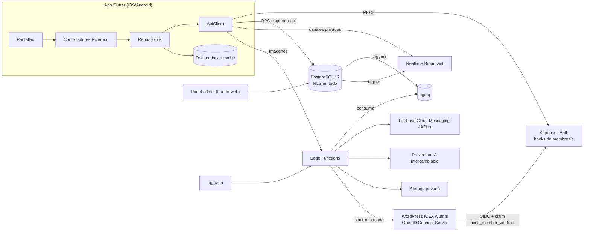

# Arquitectura de ICEX Atlas

Red social profesional privada de ICEX Alumni. Solo entran socios verificados en la web de la asociación.
Escala de diseño: **1.000 socios al arrancar, tope de 5.000** (D-001). Las decisiones razonadas están en
`decisiones.md`.

## Visión general

## Principios

1. **PostgreSQL es la fuente de verdad.** La lógica de negocio vive en tablas, políticas RLS y funciones SQL.
   Las operaciones de varios pasos (enviar mensaje, publicar, inscribirse con aforo) se hacen en una sola
   función y transacción, y son idempotentes por un id UUIDv7 que genera la app.
2. **Superficie mínima.** La Data API solo expone el esquema `api` (`config.toml`). Cada módulo vive en su propio
   esquema, sin exponer, y ningún módulo lee tablas internas de otro: usa sus funciones públicas
   (`social.is_blocked_between`, `notifications.notify`, `profiles.card`…).
3. **RLS en todas las tablas.** El test `000_rls_everywhere` falla si alguna tabla de la aplicación no lo tiene
   activado. Todas las políticas exigen `identity.is_member()`, así que un usuario de Auth sin membresía activa no lee ni escribe nada.
4. **`security definer` solo cuando es imprescindible**, siempre con `search_path = ''` (también lo comprueba un test).
   Se usa en escrituras sobre filas de otros usuarios (no leídos, notificaciones, colas) y en helpers de autorización.
5. **La clave `service_role` nunca llega a la app.** Solo la tienen las Edge Functions y la CI.
6. **Listas por cursor keyset** (`created_at, id` o el propio UUIDv7). Nunca `offset`.
7. **Contadores desnormalizados** (seguidores, recomendaciones, comentarios, no leídos, miembros, inscritos) mantenidos por triggers.
8. **Todo cambio de esquema es una migración** (`supabase/migrations`). La CI falla si la base de datos difiere de las migraciones.

## Módulos (un esquema cada uno)

| Módulo | Contenido | Lógica |
|---|---|---|
| `identity` | `members` (estado, rol: socio/moderador/admin) | Hooks de Auth `before_user_created` y `custom_access_token`, `is_member()`, revocación |
| `profiles` | perfil, trayectoria, fase, promoción, ubicación de ciudad, privacidad por campo | `card()`/`can_see()` aplican la privacidad; búsqueda con `pg_trgm` sobre columna normalizada sin tildes |
| `social` | seguidores, bloqueos | Contadores; bloquear deshace el seguimiento y oculta contenido en ambos sentidos |
| `feed` | posts (general, evento, oportunidad, logro, novedad oficial), comentarios, «Recomendar» | `get_feed` (*fan-out on read*); `feed_items` preparada para *fan-out on write* |
| `messaging` | conversaciones 1:1 con categoría (preparado para grupos), miembros, mensajes | `send_message` transaccional; mensajes **particionados por mes por rango de UUIDv7** (D-009) |
| `clubs` | clubs por ciudad, eventos, inscripciones | Aforo con bloqueo de fila y lista de espera que promociona sola |
| `notifications` | centro de notificaciones (agrupadas), preferencias, tokens push | `notify()`, colas `pgmq` (`push`, `message_events`, `embeddings`) |
| `orientador` | `documents` (pgvector 384, HNSW), `queries` | Límite diario y borrado a los 30 días |
| `moderation` | denuncias | Ocultar contenido, suspender socio |
| `config` | `app_config` (flags) | Límites, teselas del mapa, cifras oficiales de la comunidad |
| `api` | funciones RPC | Única puerta de la app y del panel; `svc_*` solo para Edge Functions |

## Flujos clave

**Acceso.** La app llama a `signInWithOAuth('custom:icex-alumni')` con PKCE. WordPress autentica y emite el ID token con
`icex_member_verified`. El hook `before_user_created` rechaza el alta si falta el claim y el hook `custom_access_token`
rechaza emitir o refrescar el JWT si la membresía no está activa. Un cron diario (`membership-sync`) pregunta a
WordPress por las bajas y revoca acceso y sesiones; un freno de seguridad impide revocar más del 5 % de una vez.
La sesión se guarda en Keychain/Keystore.

**Mensajería.** La app genera el UUIDv7 y guarda el mensaje en Drift como «enviando». Después llama a `send_message`,
que valida membresía y bloqueos, inserta el mensaje (idempotente), actualiza no leídos y encola en `pgmq`, todo en
una transacción. Un trigger publica en el canal privado `conversation:<id>` (autorizado por RLS sobre
`realtime.messages`). Al leer, `mark_read` actualiza el último leído (doble check). Al reconectar, la app pide
`get_messages(p_after = último conocido)`. `push-dispatcher` envía push solo a los destinatarios sin conexión
(heartbeat de más de 90 s).

**Feed.** `get_feed(cursor)` reúne las publicaciones propias, las de quien sigo y las de mis clubs, más las novedades
oficiales, con un *index scan* por autor (`posts_autor_created_idx`) limitado a una página por autor. Las novedades
fijadas se devuelven aparte para el banner destacado.

**Orientador.** La Edge Function reserva cupo diario, calcula el embedding de la consulta y recupera contexto con pgvector
(publicaciones y perfiles que aceptan ser sugeridos, sin bloqueados). El proveedor de lenguaje redacta los pasos; si falla,
responde un proveedor de respaldo determinista. Los alumni sugeridos salen siempre de la búsqueda, nunca del modelo.

**Imágenes.** La subida pasa por `media-upload`, que valida el tipo real (*magic bytes*) y el tamaño y elimina
EXIF/XMP con ubicación. Los buckets son privados y se leen con URL firmada y transformación de tamaño.

## App Flutter

`lib/core` (config, API, auth, router, tema, BD local, push, presencia, errores) ·
`lib/features/<feature>/{domain,data,application,presentation}` · `lib/shared` (componentes de diseño).
Usa Riverpod con generador, go_router con deep links (`/mensajes?to=`, `/post/:id`, `/perfil/:slug`, `/clubs/:id`)
y textos en ARB (es; preparado para en). Las tipografías van empaquetadas (sin Google Fonts en tiempo de ejecución).
Sentry está activo solo con DSN y se eliminan los datos personales antes de enviar.

## Rendimiento (datos semilla: 640 socios, 177 posts, ~15.000 seguimientos)

Medido con `scripts/perf.sh` (100 socios distintos, como `authenticated` con RLS y `EXPLAIN ANALYZE`). La CI falla si
cualquier p95 llega a 200 ms.

| Llamada | p50 | p95 | máx |
|---|---|---|---|
| `get_feed` (1.ª página) | 33,7 ms | 51,3 ms | 77,9 ms |
| `get_feed` (siguiente página) | 13,9 ms | 27,2 ms | 31,8 ms |
| `search_directory` (texto, `pg_trgm`) | 3,2 ms | 5,1 ms | 6,2 ms |
| `search_directory` (filtros/pestañas) | 1,8 ms | 3,2 ms | 4,1 ms |

El coste de `get_feed` crece con el número de personas seguidas (un *index scan* corto por autor). Con 5.000 socios
y unos 100 seguidos de media sigue holgado. Si se superase, se activaría `feed_items` (*fan-out on write*).
